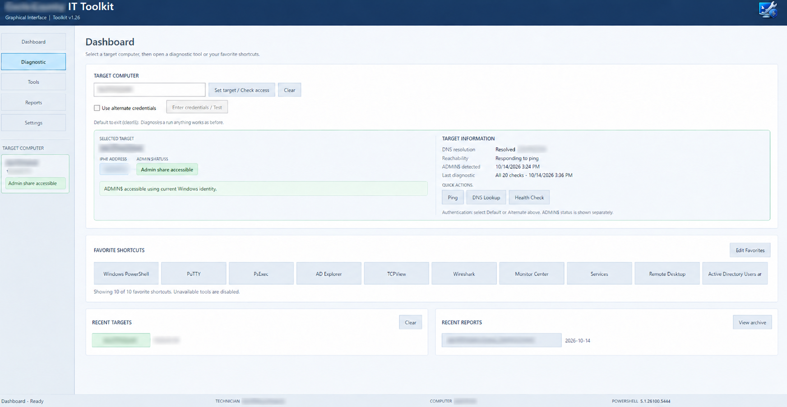

# IT Toolkit

**Development version 1.27 (local snapshot validation pending)** · Windows PowerShell 5.1 · Windows administration and diagnostics

> **Release status:** `develop/v1.27` is the active development branch. **v1.26 on `main` remains the stable production release.** v1.27 includes implemented GUI refinements, interface switching, and shared direct-local diagnostic collectors. The earlier workplace diagnostic checklist was completed, but local snapshots were subsequently identified as a release gap. Windows snapshot validation remains pending. See [ROADMAP.md](ROADMAP.md).

The **IT Toolkit** is a portable, PowerShell-based utility for IT technicians who troubleshoot and document Windows workstations and servers. It provides a graphical interface and a Classic console menu for remote diagnostics, access checks, reporting, and system inventory comparisons.

> **Platform support:** The current toolkit is designed for **Windows**. Its graphical interface uses Windows Presentation Foundation (WPF), and several collectors use Windows-specific management APIs. **macOS and Linux are not supported by this release.** A cross-platform edition is a potential future project.

## Features

- **Two interfaces:** Windows GUI and numbered Classic PowerShell menus. On the v1.27 development branch, the Classic main menu numbers are grouped sequentially and both interfaces offer a switch to the other under the current Windows process identity (Windows validation pending). No target selection or alternate credential is transferred.
- **v1.27A GUI refinements (development branch):** Multiline labels on Tools and Dashboard favorite buttons; improved display of long target names, recent reports, and footer text in narrower windows.
- **v1.27A window preferences (development branch; Windows-tested):** Remembers main GUI size, position, maximized state, and last open page per technician. Off-screen or invalid saved layouts fall back to default placement; previously selected targets are not automatically reconnected.
- **Remote access checks:** DNS resolution, ICMP reachability, WMI, WinRM, and `ADMIN$` accessibility.
- **Credential selection:** Run supported diagnostics with your current Windows identity or explicitly supplied alternate administrative credentials. Credentials are not intended to be stored in configuration files.
- **Windows diagnostics:** Collect information across system, storage, services, hardware, local accounts and groups, shares, software, updates, tasks, firewall, events, and related categories. Some checks require particular remote services or privileges.
- **Health-oriented reporting:** Review collected findings and access-check results; unavailable or unsuccessful checks are reported separately from successful results.
- **Exportable reports:** Save diagnostic output in HTML, CSV, or TXT, and browse previously saved reports. In v1.27 development, GUI HTML report opening launches Microsoft Edge directly when installed to address alternate-credential Windows shell issues; other formats retain the Windows shell `Open` action (administrative-launch HTML opening verified on the affected Windows workstation; other-format and broader regression validation pending).
- **Snapshots and comparisons:** Create structured JSON inventory snapshots from the GUI or Classic interface, then compare two captures to identify changes in services, installed software, updates, users, groups, administrators, and shares.
- **Tool integration:** Locate and launch supported external troubleshooting utilities, including optional Microsoft Sysinternals tools and PortQry when installed.

## Requirements

- **Windows 10/11 or supported Windows Server**, with **Windows PowerShell 5.1** and .NET/WPF support for the graphical interface.
- Network connectivity to the systems being checked.
- Appropriate authorization on each remote target. Individual diagnostics may require WMI/DCOM, WinRM, SMB, firewall rules, or elevated permissions.
- Optional: [Microsoft Sysinternals](https://learn.microsoft.com/en-us/sysinternals/) and [PortQry](https://www.microsoft.com/en-us/download/details.aspx?id=17148) for the related external-tool integrations. The toolkit can warn if an optional dependency is not found.

No agent is installed on remote target computers by the toolkit's launcher.


## Screenshots

### Graphical Dashboard

The IT Toolkit provides a graphical dashboard for remote system diagnostics, administrative access checks, reporting, and favorite utilities.



## Installation

1. For the stable release, download the **v1.26 release ZIP** from [GitHub Releases](https://github.com/wisper1977/ITToolkit/releases/tag/v1.26). For the in-progress v1.27 build, switch to [`develop/v1.27`](https://github.com/wisper1977/ITToolkit/tree/develop/v1.27) and clone or download that branch. Extract into a local folder, such as `C:\ITToolkit`.
2. Keep `Modules`, `Branding`, the `.ps1` files, and `Toolkit-config.json` together in their original relative paths.
3. Review `Toolkit-config.json` and update paths, reporting options, and the default authentication domain for your environment.
4. On Windows, run **`Launch.cmd`** to open the launcher and choose the GUI or Classic interface.

You can also start the Classic console directly:

```powershell
powershell.exe -NoProfile -ExecutionPolicy Bypass -File "C:\ITToolkit\ITToolkit.ps1"
```

Or start the GUI in an STA Windows PowerShell session:

```powershell
powershell.exe -NoProfile -STA -ExecutionPolicy Bypass -File "C:\ITToolkit\ITToolkit-GUI.ps1"
```

The example commands use a process-only execution-policy override; follow your organization's script-execution and code-signing requirements rather than bypassing enforced policies.

## Basic workflow

1. Select or enter a Windows computer or server as the target.
2. Choose **Default** credentials, or explicitly provide **Alternate** credentials when needed.
3. Run access checks and the diagnostics relevant to the issue.
4. Save a report for documentation, or create a snapshot as a baseline.
5. After a change or later investigation, capture another snapshot and compare the two.

Snapshot comparisons are inventory differences, **not** a substitute for security auditing or a guarantee that a computer is healthy. Some services normally stop when idle, and some collectors can return partial results due to permissions or transport restrictions.

## Project layout

```text
ITToolKit/
├── Launch.cmd
├── ITToolkit-Launcher.ps1
├── ITToolkit-GUI.ps1
├── ITToolkit.ps1
├── Toolkit-config.json
├── Branding/
├── Modules/
└── Reports/
```

The release distribution may omit development test scripts. They are not required for routine use.

## Security and responsible use

This toolkit is intended for **authorized administration only**. Remote checks can reveal sensitive host, account, share, software, and network information.

- Run it only against systems you are authorized to administer.
- Treat generated reports and snapshots as potentially sensitive operational data.
- Never commit passwords, credential files, private keys, or report archives to GitHub.
- The `ADMIN$` check uses SMB; existing sessions and credential conflicts can affect its result. Avoid disrupting pre-existing SMB connections.
- Review the repository contents and branding before publishing. The included configuration contains **Cochise County-specific defaults** and should be adapted for other environments.

## Current limitations

- Windows PowerShell 5.1 and WPF are Windows-specific; this is **not** a native MacBook application.
- Remote feature availability depends on permissions, operating-system capabilities, protocol configuration, and firewall settings.
- An access check succeeding does not guarantee that every diagnostic collector will succeed.
- Snapshot collection and comparison are designed for the supported inventory categories; they do not represent a complete forensic record.

## Version history

### v1.27 (in development)

**v1.27A — GUI refinement (completed and Windows-tested)**

- Updated the Tools page and Dashboard Favorite Shortcuts to display long tool names on multiple lines with centered labels.
- Improved layout handling for long target computer names and recent target entries.
- Adjusted recent report filename display while retaining full paths in tooltips.
- Improved footer handling of technician and computer names when space is limited.
- Updated `Toolkit-config.json` to version `1.27` on the development branch.

**v1.27A follow-up — Window state persistence (implemented; Windows-tested)**

- Saves the main GUI's normal restore bounds, maximized state, and last opened page in the existing per-user `GUISettings.json` preferences.
- Checks saved dimensions and monitor visibility before restoring; malformed or off-screen values use defaults.
- Restores page navigation only, without automatically selecting or reconnecting to previous targets. The launcher remains independent.
- **Validated on Windows:** Restored moved/resized and maximized windows, last-page navigation, Favorites and Recent Targets preservation, and startup without automatically selecting a target. Disconnected-monitor and corrupted-preference recovery have not been separately tested.

**v1.27B — Shared diagnostic status handling (first increment; Windows testing pending)**

- A shared diagnostic classification now distinguishes `Success`, `NoData`, `Review`, `Partial`, `Unavailable`, `AccessDenied`, `NotTested`, and `Unknown` without replacing the collectors' original status or error detail.
- The shared dispatcher adds a `StatusCategory` field to its results; the Classic alternate-credential formatter and GUI default/alternate diagnostic reports can display the category.
- Classic alternate-credential report section objects retain the structured `StatusCategory` field.
- **v1.27B follow-up:** Shared exception handling in the dispatcher and both GUI diagnostic modes now distinguishes explicit authorization-denied errors (`ACCESS DENIED` / `AccessDenied`) from other failures (`UNAVAILABLE` / `Unavailable`). The original exception message is preserved. A nonexistent or unreachable host is not classified as access denied solely because collection failed.
- **v1.27B message clarity (GUI Default Windows-tested):** New collection failures display `Error details:` rather than the ambiguous `UNAVAILABLE / ACCESS DENIED / ERROR:` heading. Status and category remain separate. The Classic/GUI Default status parser accepts both new and legacy headings, classifying from the actual error message; GUI worker exception output uses the same neutral wording. GUI Default Firewall diagnostic against a computer with WinRM stopped confirmed `STATUS: UNAVAILABLE`, `Status category: Unavailable`, and the original WinRM connection message under `Error details:`.
- **v1.27B correction (Windows-tested in GUI Default mode):** The shared Classic/GUI Default report status parser now removes the generic `UNAVAILABLE / ACCESS DENIED / ERROR:` prefix before looking for explicit permission-denied evidence. An RPC-unavailable message was confirmed to display `STATUS: UNAVAILABLE` and `Status category: Unavailable`, while retaining its original error text.
- The existing Classic Default diagnostics continue using their established `Get-SectionStatus` logic; a full cross-mode parity test is still pending.
- Existing diagnostic collection methods, authentication selection, and saved report formats remain in place. **The change needs Windows regression testing before v1.27B can be considered complete.**

**v1.27C foundation (development branch):** Added a read-only direct-local collector module for System and Firewall checks. It uses local CIM and firewall cmdlets without remote WinRM/ADMIN$ and returns structured status and error information. Current Windows identity only in this increment; secure alternate-admin execution and interface integration remain planned. **Windows-tested:** System and Firewall returned `SUCCESS`/`Success` with populated data and no errors on Windows 11 Pro, with WinRM stopped. Access-denied and other failure paths remain untested.

**v1.27C local target integration (development branch; Windows testing pending):** The Dashboard now offers **Use Local Computer**, and Classic main menu option **13** selects the local machine. Both route System and Firewall diagnostic reports through the same direct-local collector under the current Windows identity; remote WinRM and ADMIN$ are not used for those checks. Other local sections explicitly show `NOT TESTED` rather than silently running remote collectors. Local snapshots and alternate-admin local execution are not yet supported; the remaining remote-only Classic tool categories require selecting a remote target. Windows validation confirmed GUI local Firewall `SUCCESS` and unsupported local Users `NOT TESTED`; Classic local report saving also passed. GUI local report saving initially failed due to a mode-check mismatch; a fix now recognizes Local and labels saved reports as LOCAL. **GUI Local-mode report saving has now been retested successfully on Windows using a Services diagnostic before its local collector was integrated. The user confirmed that all saved reports tested opened successfully. Individual format coverage has not been enumerated; remaining regression tests are pending.**

**Core naming cleanup (development branch; Windows retest pending):** `ITToolkit-Core.ps1` now defines approved-verb functions `Wait-ToolkitContinue` and `Set-ToolkitTarget`. Compatibility aliases retain `Pause-Toolkit` and `Change-Target` behavior for existing calls, without changing target selection or credentials.

**v1.27C local Services increment (implemented; Windows validation pending):** Both GUI and Classic can now collect the Services section directly from local `Win32_Service` CIM data (without remote WinRM/ADMIN$). The read-only report includes number of services queried and automatic-start services not currently running, matching the existing remote diagnostic scope. An empty finding list is still a successful query if services were enumerated. This does not diagnose all service health issues, and no service is changed. Previous Services `NOT TESTED` results predate this increment.

**Future development:** See the [IT Toolkit Roadmap](ROADMAP.md) for upcoming milestones, enterprise local diagnostics, Quick Fix, NIST/best-practices checks, and additional proposals. Planned features are not included in the current build.

### v1.26

- Expanded Default and Alternate credential support across diagnostic workflows.
- Integrated credential-aware access checking for WMI, WinRM, and `ADMIN$`.
- Improved GUI and Classic reporting and result-status presentation.
- Added GUI and Classic snapshot creation with structured JSON comparisons.

See the [complete changelog](CHANGELOG.md) for the documented release history through v1.26. The v1.27 work above is currently documented in this development-branch README.
---
## License

Cochise County IT Toolkit is licensed under the
GNU General Public License, Version 2.0 (GPL-2.0-only).

Copyright (C) 2026 Chris Collins

See the [LICENSE](LICENSE) file for the full license text.

*Developed for IT workflows. This development-branch README documents v1.27 work in progress; v1.26 remains the stable Windows release.*

**v1.27C Local Services collector validation (Windows-tested independently; interface tests pending):** The direct-local `Win32_Service` collector returned `SUCCESS`/`Success` with no errors on Windows workstation `DESKTOP-8EHGAPD`, querying 324 services and identifying seven automatic-start services that were not running. Findings are evidence for review, not confirmed service faults. Local GUI and Classic Services execution, report formatting/saving, and remote regression checks remain to be validated.

**v1.27C GUI Local Services display validation (Windows-tested):** GUI local Services report on `DESKTOP-8EHGAPD` displayed `SUCCESS` / `Success`, 324 queried services and seven automatic-start services not running, matching the direct collector test. GUI report save/reopen for Services, Classic Services validation, and remote regression tests are still pending.

**v1.27C Classic Services and interface navigation (Windows validation partial):** Classic local Services collection and output were confirmed working by the technician. Classic main-menu numbering is now sequential (1–14), with Local Computer at option 10, Settings/Tools/Credentials at 11–13 and Switch to GUI at 14. GUI sidebar offers **Switch to Classic**, positioned beneath the Target Computer panel and anchored at the bottom of the left sidebar (Windows-tested). Switching starts the other interface as the currently signed-in Windows process identity; it does not reauthenticate through the launcher, transfer alternate credentials, or restore a target. Windows switch testing and remaining report regression tests are pending.

**GUI interface switch placement (Windows-tested, 2026-10-14):** The technician confirmed the bottom-aligned **Switch to Classic** button beneath the Target Computer panel works as intended. This validation covers the revised positioning and switch action; unrelated diagnostic and credential regression tests remain pending.

**Local Services report saving (technician-confirmed, 2026-10-14):** Saving a Local Services diagnostic report works in Windows testing. Exact interface and per-format HTML/CSV/TXT coverage were not specified by this confirmation and remain to be independently enumerated; remote regression tests remain outstanding.

**v1.27C Local Storage increment (implemented; Windows verification pending):** GUI and Classic now route local Storage diagnostics through the shared read-only `Win32_LogicalDisk` collector. It reports fixed logical drives (`DriveType=3`), volume name, capacity GB, free GB, and free percentage. Unknown or zero capacity does not produce a misleading percentage. No fixed disks yields `NO RESULTS` / `NoData` rather than a healthy-drive assertion. Remote Storage behavior is unchanged. Windows collector, GUI/Classic, saving, and regression testing remain pending.

### Developer smoke test: local diagnostics

On Windows PowerShell 5.1, run `powershell.exe -NoProfile -File .\Test-LocalDiagnostics.ps1` from the repository root. The test dot-sources the current collector on each invocation, checks section support, and displays fresh results. Default section: **Health**; optionally supply `-Section Services`, `-Section System`, or `-Section Firewall`. As new local collectors are added, update the script's default section. This smoke test is read-only; it does not replace GUI/Classic tests or establish host health. The test harness itself awaits Windows verification.

**Local Storage direct collector validation (technician-confirmed, 2026-10-14):** Windows PowerShell returned `SUCCESS`/`Success` with no error and two fixed logical drives (C: and E:), including size, free GB, and percentage. GUI/Classic Storage output and report-save checks remain pending.

**v1.27C Storage interface validation (Windows technician-confirmed, 2026-10-14):** Storage diagnostics work in GUI and Classic; an HTML Storage report saved and reopened successfully. CSV/TXT and remote regression remain unverified.

**v1.27C Local Network increment (implemented; Windows verification pending):** Shared local Network collector now queries IP-enabled adapter configuration using `Win32_NetworkAdapterConfiguration`, reporting adapter description/index, MAC, DHCP state, IP addresses, subnet masks, gateways, DNS servers and suffix. It performs no local network changes and does not rely on WinRM. This intentionally describes local network configuration rather than reproducing remote-target ping/traceroute checks; no adapters returns `NoData`. GUI and Classic local paths are enabled; Windows testing remains pending. `Test-LocalDiagnostics.ps1` now defaults to Network.

**v1.27C Local Network Windows validation (2026-10-15):** Technician confirmed Network reports work in GUI and Classic, and an HTML report saves and opens. The local report correctly displayed two IP-enabled adapters, including an Ethernet APIPA address and Wi-Fi configuration. CSV/TXT and remote regressions remain pending.

**v1.27C Local Hardware implementation (Windows test pending):** Shared read-only Hardware collector now includes computer manufacturer/model, RAM, BIOS version and serial number, CPU model/core/thread counts, and physical disk model/size when enumerated. GUI and Classic both use the common local collector without requiring WinRM. The single-file test harness now defaults to Hardware. Hardware collector, both interfaces, and saved reports still need Windows validation.

**2026-10-15 Windows validation:** Local Hardware ran successfully in GUI and Classic, and HTML reports saved and opened. The report showed ASUS system information, 31.9 GB RAM, AMI BIOS 2301, Intel i7-10700K (8 cores/16 threads), and a Samsung SSD. Physical disk listing can be cross-checked against the separately observed E: logical volume in later testing.

**Local Users (Windows test pending):** Implemented read-only local account inventory (name, domain, SID, disabled and lockout state) with shared GUI/Classic collection. Test-LocalDiagnostics.ps1 now defaults to Users. Report and error-path verification are pending.

**2026-10-15 Local Users Windows confirmation:** Technician confirmed the Users report ran in GUI and Classic and saved/opened as HTML. It enumerated seven local accounts, including enabled and disabled records; disabled status is observed data, not inherently a fault. CSV/TXT and remote regression tests remain pending.

**v1.27C Local Groups (implemented, Windows validation pending):** The shared read-only collector now queries local `Win32_Group` records, reporting group domain, name, SID and description. Both interfaces use the local collector without WinRM. Group membership enumeration remains a separate enhancement; this increment does not claim to inventory members. `Test-LocalDiagnostics.ps1` defaults to Groups.

**Local Groups Windows validation (2026-10-15):** Technician confirmed successful GUI and Classic execution and HTML save/open.

**Local Administrators (Windows verification pending):** The shared collector reads direct members of built-in Administrators by SID S-1-5-32-544. It reports member identity/type/source and SID without changing permissions or expanding nested domain groups. Both interfaces are wired; the smoke-test default is Administrators.

**Local Administrators Windows validation (2026-10-15):** Technician confirmed `SUCCESS` in GUI and Classic and successful HTML save/open. Report enumerated two direct members of the built-in Administrators group: local Administrator and one Microsoft-account-backed user. Built-in Administrator was previously reported disabled; group membership alone does not establish that the account can sign in. Domain group nesting is not expanded. CSV/TXT and remote regressions remain pending.

**v1.27C Local Shares implementation (Windows validation pending):** Shared collector uses local read-only `Win32_Share` inventory including administrative shares, reporting name, backing path, description and share type. Does not read share permissions or NTFS ACLs and performs no connection or share modification. Both GUI and Classic are routed through the shared collector; `Test-LocalDiagnostics.ps1` defaults to Shares.

**Local Shares Windows validation (2026-10-15):** Technician confirmed `SUCCESS` in GUI and Classic and successful HTML save/open. Results listed standard ADMIN$, C$, E$ and IPC$ entries, including administrative share type codes. This does not establish remote share accessibility or ACL permissions; CSV/TXT and remote regression remain pending.

**Local Software implementation (Windows verification pending):** Both local interfaces now use the shared read-only machine-wide uninstall-registry collector, which explicitly reads 64-bit and 32-bit HKLM registry views (where applicable), collecting display name, display version and publisher. It does not query `Win32_Product`, modify packages, or promise exhaustive coverage of Store, per-user, or portable apps. The reusable smoke test now defaults to Software. Windows test and report validation are pending.

**Local Software Windows validation (2026-10-15):** Technician confirmed all tests passed, including GUI, Classic and saved HTML reports. The displayed successful local report included a substantial machine-wide uninstall registry inventory with app name, version and publisher. Blank version/publisher fields reflect available registry data; this does not establish exhaustive software coverage. CSV/TXT and remote regression remain pending.

**v1.27C Local Updates increment (Windows validation pending):** The shared read-only collector now lists installed Windows QFE hotfix records (`Win32_QuickFixEngineering`), with KB ID, description, installation date and installer. Both GUI and Classic route local Updates through the collector, and the test script defaults to Updates. This first increment is installed-hotfix inventory only: it does not detect missing patches, update compliance or recent Windows Update failure events. The remote Updates report is unchanged; Windows validation remains pending.

**Local Updates Windows verification (2026-10-15):** Technician confirmed all checks completed successfully, including local GUI and Classic plus HTML save/open. Six QFE hotfixes were reported, including October 14 security updates; one update had blank install metadata. The missing fields are retained, not inferred. CSV/TXT and remote regression remain pending.

**v1.27C Local Scheduled Tasks (Windows verification pending):** Shared read-only `Get-ScheduledTask` collector now returns task path, name and state, plus last/next run and last result via `Get-ScheduledTaskInfo`. Individual task-info failures are explicitly marked unavailable; the inventory does not run, enable, disable or modify tasks. Both local interfaces support Tasks and the test script defaults to Tasks. Windows performance, permission edge cases, HTML saving and remote regressions remain pending.

**Local Scheduled Tasks validation (2026-10-15):** Technician confirmed all checks passed, including GUI and Classic execution plus HTML save/reopen. The saved local report enumerated a substantial range of scheduled tasks, their state, last/next run and result codes. Placeholder last-run dates (such as 1999) and nonzero last result codes are retained as Task Scheduler data, not automatically treated as collector failures. CSV/TXT and remote regression remain pending.

**Local Event Logs increment (Windows verification pending):** Both local interfaces now use a shared read-only event collector for the last seven days of System/Application error events, limited to 25 per log. The output includes per-log query status/count and selected event metadata and shortened messages. No matching errors is reported as an observed no-data log, while inaccessible logs produce a visible partial collection status. No event logs are modified. The smoke test defaults to Events; Windows GUI/Classic and HTML report validation remain pending.

**Local Events Windows validation (2026-10-15):** Technician confirmed Events executes in GUI and Classic and the report saves and opens in HTML. System log reported 13 error events and Application reported `NoData` (zero matching error events) in the seven-day query window, while the overall collection succeeded. Observed DCOM failures connecting to `WisperPC` and WindowsUpdateClient app install failures (0x80073D02) are diagnostic evidence for later review, not collector failures.

**v1.27C Local Startup increment (Windows test pending):** Shared direct-local collector now uses read-only `Win32_StartupCommand` to inventory startup entry name, location, user, and command. It matches the remote Startup scope but is not a comprehensive inventory of all Windows autostart mechanisms. Both interfaces route Startup through the local collector, and the test harness defaults to Startup. HTML save/open and Windows validation remain pending.

**Local Startup validation (2026-10-15):** GUI and Classic ran successfully and HTML reports saved/opened; Run registry and Common Startup entries were shown.

**Local BitLocker (Windows validation pending):** Shared read-only volume status inspection via `Get-BitLockerVolume` now works through both local interface routes. Reports volume protection/encryption/lock state and percentage but does not access or export recovery secrets or key protectors. The test harness defaults to BitLocker. Windows validation pending.

**BitLocker Windows permission-path result (2026-10-15):** A local run returned ACCESS DENIED / AccessDenied. This validates honest permission-error reporting, not successful BitLocker inventory; positive-path testing remains pending.

**Local Sessions implementation (Windows test pending):** Read-only local `quser.exe` output is now collected by GUI and Classic. The reusable smoke test defaults to Sessions. The query requires no credential substitution and fails visibly if local session enumeration is restricted.

**Local Sessions Windows validation (2026-10-15):** Technician confirmed local session collection in GUI and Classic and HTML report save/open. Output correctly identified the active console session for `wispe` using `quser.exe` under the current Windows identity. Additional remote regression and CSV/TXT testing remain pending.

**v1.27C Local Computer Policy implementation (Windows validation pending):** The shared local collector now runs `gpresult.exe /SCOPE COMPUTER /R` without a remote computer parameter, preserves report lines and checks its exit code. Failures (including insufficient rights or unavailable RSoP data) are visible; no gpupdate, elevation or policy modification occurs. Both GUI and Classic local paths include Policy. The reusable script defaults to Policy. Windows collector, interface display, HTML save/open and error-path validation remain pending.

**Policy negative-path test (2026-10-15):** Windows returned ACCESS DENIED; error handling is verified, but successful policy collection remains pending.

**Local Share Permissions (Windows verification pending):** Read-only collection for ordinary local SMB shares now includes share ACLs and NTFS root ACL entries. Special/admin shares excluded, no ACL mutation or effective-access claim. A zero-share summary is valid; individual read errors are reported as PARTIAL. Both interfaces are enabled and the test harness defaults to SharePermissions.

**Local SharePermissions Windows validation (2026-10-15):** Technician confirmed GUI and Classic collection with HTML save/open. One ordinary `Screenshots` share was inventoried; share ACLs and root NTFS ACLs were both reported. `Everyone` had Full share permission but ReadAndExecute on the NTFS root, illustrating why those permission layers must remain distinct. No effective access assertion was made.

**v1.27C Local Health evidence summary (Windows validation pending):** Local GUI and Classic now use a read-only collector covering system-drive free space, automatic-start services currently stopped, and up to 100 System critical/error events from the past 24 hours. Per-check query failures are marked `PARTIAL`; zero matching event records are distinguished from inaccessible logs. No remote ping/ADMIN$ checks are attempted locally. This is an evidence inventory, not the v1.27D evidence-based health analysis. The reusable test script defaults to Health. BitLocker and Policy positive-path validation remain outstanding.

**Local Health Windows validation (2026-10-15):** GUI and Classic tests completed successfully and HTML reports saved and reopened. Observed C: 31.4% available (145.72 GB), 324 services queried with 6 automatic-start services not running, and 8 System critical/error events in 24 hours. These are observations, not a health rating. 18 of 20 local sections have passed Windows positive-path testing. BitLocker and Policy still need authorized positive-path tests; their access-denied error handling was verified.

**2026-10-15 elevated BitLocker/Policy collector verification:** On `DESKTOP-8EHGAPD`, an authorized, elevated Windows PowerShell 5.1 session (`IsInRole(Administrator) = True`) returned `SUCCESS` for both `Test-LocalDiagnostics.ps1 -Section BitLocker` and `-Section Policy`. BitLocker listed C: (operating system) and E: (data), both FullyDecrypted, protection Off, encryption 0%, method None and Unlocked. Policy returned 37 lines showing a standalone workstation and local computer policy RSoP; Local Group Policy was filtered as Not Applied (Empty). Prior non-elevated tests correctly returned ACCESS DENIED. **Both command-line collectors now have positive-path Windows tests, but GUI and Classic elevated execution and HTML save/reopen for these two sections remain unverified.** Do not mark v1.27C fully cross-interface validated until those checks pass. Neither collector modifies settings or retrieves recovery secrets.

**v1.27C targeted local UAC handoff (Windows validation pending):** GUI Diagnostics now offers **Run selected with UAC** for a single Local BitLocker or Policy section; the default diagnostic action still uses the current non-elevated process. Classic offers a Y/N UAC retry only after a local BitLocker/Policy ACCESS DENIED. A Windows UAC process runs only the selected read-only collector using the existing module and returns a temporary CLIXML result through a directory restricted to the current user, Administrators and SYSTEM. The handoff verifies the elevated identity matches the original Windows identity; alternate UAC identities are explicitly rejected (no silent impersonation). Temporary data are deleted after collection. GUI results go through the existing save-report flow; the GUI process is not elevated. **Requires Windows validation** of UAC consent/cancel/alternate-account handling, both interfaces, normal HTML report saving, and no-regression tests. Do not mark v1.27C complete yet.

**Targeted GUI UAC Windows test (2026-10-15 07:18):** Technician confirmed normal GUI Local BitLocker `Run selected with UAC` returned SUCCESS under the same Windows identity with C: and E: displayed (FullyDecrypted, protection Off, 0% encrypted, method None, Unlocked). Avast attempted to block the elevated helper, but the diagnostic completed. Treat antivirus interference as an unresolved compatibility/security review, not proof of a false positive; review Avast's exact detection and provenance before changing implementation or making exceptions. Policy GUI elevation, Classic retry, GUI HTML save/reopen, cancellation, alternate-identity and remote regression remain unverified.

**GUI Copy Report (Windows validation pending):** Diagnostics now has a **Copy Report** button anchored at the far left of the report-action row, with format and Save Report controls remaining on the right. After collection, Copy Report copies the exact displayed diagnostic text to the Windows clipboard without rerunning the check or saving a file. It is disabled until a valid report exists, refuses stale/changed target or identity contexts, and reports clipboard errors in the GUI. Pasting may disclose diagnostic information to its destination; technicians should review content before sharing. Windows layout/clipboard tests remain pending.

**Workplace UAC compatibility test (2026-10-15):** On `IT-7PY1M84`, non-elevated GUI BitLocker and Policy correctly returned `ACCESS DENIED`. Explicit GUI UAC for both failed before any result returned (`The elevated process did not provide a diagnostic result`). Copy Report was used successfully to share the displayed diagnostic failure, but report-saving behavior was not established. The underlying cause is not yet known; a different UAC administrative account, endpoint controls, or child-process failure are plausible and must be checked against authorized Windows/security logs. The elevation helper now distinguishes UAC cancellation, process start failure, and process exit-without-an-accessible-result, including exit code and context. No silent identity switching, privilege bypass or endpoint exclusion was introduced. Windows retest required.

**v1.27 separate-admin UAC handoff (Windows validation pending, 2026-10-15):** The shared local BitLocker/Policy UAC helper now supports Windows credential prompts supplying a separately authorized administrator account. The initiator and actual elevated collection identity are separately identified and shown in GUI/Classic reports, which continue through the existing display, copy and save workflows. The child verifies its administrator token and returns explicit failure information when possible; the parent validates request correlation, target, section, mode and elevated-status evidence. Temporary result permissions remain limited to the initiating SID, local Administrators and SYSTEM. Windows manages credentials; no password is collected, saved or placed in command arguments, and there is no silent account substitution. **The two-account workplace case and parent-profile temporary-path access require Windows testing**; do not claim a successful fix yet. Endpoint security blocking and script-execution restrictions must not be bypassed.

**Enterprise UAC execution-policy restriction (2026-10-15):** On workplace host `IT-7PY1M84`, Windows UAC successfully started the scoped BitLocker/Policy child under an explicitly entered administrator account, but Windows PowerShell refused to load `Modules/ITToolkit-LocalDiagnostics.ps1` because running scripts is disabled for that process. This is a **script-execution policy blocker, not a BitLocker or Policy collector defect**. The helper now reports this condition explicitly, directs administrators to inspect `Get-ExecutionPolicy -List` in the authorized admin context and use approved organizational script-signing/policy deployment. It does not change or bypass execution policy. Positive-path workplace UAC and saved-report validation remain pending.

**Opt-in workplace UAC PowerShell policy configuration (Windows validation pending, 2026-10-15):** The GUI and Classic now separately ask for explicit consent to set the UAC administrator account's persistent `CurrentUser` execution policy to `RemoteSigned` **only if** that elevated account has an effective `Restricted` policy and both Group Policy scopes are confirmed `Undefined`. Declining the optional change still permits a UAC diagnostic attempt under existing policy; cancelling the GUI prompt aborts collection. No LocalMachine/MachinePolicy/UserPolicy settings are modified, and neither ordinary diagnostics nor the parent toolkit account is changed. The elevated read-only report identifies the real collection identity, policy before/after, and whether a change occurred. Failed collection also reports if the account-level policy was changed before the failure. The existing Windows UAC credential prompt remains in charge of authentication. Workplace GUI/Classic, successful post-policy collection, reporting, cancellation and endpoint-security compatibility still require Windows testing.

**Workplace validation (2026-10-15):** The normal GUI on `IT-7PY1M84` initiated an explicitly authorized Windows UAC diagnostic under a different administrator account. The returned Policy report identified both initiating and collecting accounts, recorded `Restricted` → `RemoteSigned` and confirmed the elevated account's persistent `CurrentUser` policy changed. The child module executed and returned a structured diagnostic result: `ACCESS DENIED` from `gpresult /SCOPE COMPUTER /R`. **UAC cross-account collection and optional execution-policy change are positively validated; Policy data retrieval is not.** Inspect computer-scope RSoP access with approved credentials before altering the collector. Local GUI header now distinguishes read-only queries from the separately authorized persistent setting change. Policy UAC HTML save/open, BitLocker workplace UAC, Classic and remote regression remain pending.

**Validated on workplace Windows (2026-10-15):** GUI local BitLocker collection from `IT-7PY1M84` succeeded under separately UAC-authorized `COCHISE\CCollinsadm`, launched by standard `COCHISE\ccollins`. The report correctly identified both accounts and confirmed no further execution-policy change (`RemoteSigned` → `RemoteSigned`, changed `False`). Read-only output showed operating-system volume C: fully encrypted, 100%, XTS-AES-256, Protection On, Unlocked. This validates the **GUI cross-account privileged BitLocker collection**, not GUI Save HTML/reopen, Classic UAC, or the Policy positive path (Windows `gpresult /SCOPE COMPUTER /R` independently returned Access Denied under an elevated administrator token).

**Workplace validation closeout (2026-10-15):** The technician reports completing the agreed final workplace checklist, including Classic elevated BitLocker, explicit UAC cancel and policy-choice behavior, GUI elevated HTML/CSV/TXT save and reopen, Recent Reports and Archive, Copy Report, target/identity isolation, default and alternate remote tests, interface switching, GUI startup/preferences, local diagnostics without WinRM/ADMIN$, and endpoint-security compatibility. This is a **technician-reported completion**; the prior successful GUI BitLocker result was directly shared, but individual output for every later check was not supplied. Windows computer-scope Policy evidence remains unavailable on the affected workstation because `gpresult` independently returns `ACCESS DENIED` in an elevated administrator console. v1.27 is a release candidate, **not yet promoted to production**. Earlier test-pending notes above document the history before this closeout.

**v1.27 local snapshot implementation (Windows testing pending, 2026-10-15):** Both GUI Create Snapshot and Classic Create Snapshot now accept explicitly selected Local Computer mode. Seven comparison categories (Services, Software, Updates, Users, Groups, Administrators, Shares) use local WMI and local uninstall-registry reads, with no remote computer parameter, WinRM, SMB admin share or alternate credentials. The resulting SchemaVersion 1 JSON file is compatible with the existing snapshot archive and comparisons; target and identity are recorded, failed categories are marked unavailable rather than silently omitted, and no file is saved if all seven categories fail. Classic optional report sidecars also use the local collector when local mode is active. **This functionality requires positive Windows GUI and Classic capture, reload, baseline comparison and regression tests before release.** Earlier release-candidate wording reflected the completed workplace *diagnostic* checklist, not this uncovered snapshot gap.

**Windows snapshot verification (October 15, 2026):** The technician confirmed that **local and remote snapshot creation both work** after the v1.27 direct-local snapshot implementation. This supports the new local capture path and confirms the existing remote capture path remains functional. This confirmation does not by itself document testing of two-snapshot comparison results, malformed/partially unavailable category handling, or every saved-report snapshot sidecar; those checks remain separate release-review items.

**v1.27 Elevated PowerShell tool (Windows validation pending, 2026-10-15):** A built-in **Windows PowerShell (Administrator)** entry is available in the shared Tools catalog and Favorites in both GUI and Classic. After an explicit confirmation, it launches a separate Windows PowerShell 5.1 console using Windows UAC (`RunAs`). In enterprise configurations UAC may prompt for a different administrator identity. IT Toolkit itself stays in the original standard-user session, does not receive or store the administrator credentials, does not inherit remote alternate-target credentials for this local launch, and does not silently modify execution policy. Confirm approved launch, UAC cancellation, actual elevated identity, GUI/Classic behavior and unchanged normal PowerShell tool on Windows before release.

**v1.27 evidence-based health dashboard — initial implementation (Windows validation pending, October 15, 2026):** The local Quick health check now uses a shared analysis engine in GUI and Classic. Analysis interprets only collected evidence for system-drive free percentage (review below 10%), automatic-start services not running (review, not automatically a fault), and critical/error System event counts for the last 24 hours (bounded to 100 records). Individual available, unavailable, and review counts and evidence-based next steps appear in the local Health report; the GUI Dashboard includes a last-local-health summary. No invented overall health score; unsuccessful or absent checks are **unavailable**, not passed. Further coverage of other diagnostic categories and compatible remote evidence, saved-report rendering and Windows regression validation remain **in progress for v1.27**, not a future milestone.

**Elevated PowerShell tool validation:** Technician confirms the separately UAC-launched Windows PowerShell (Administrator) tool works as intended on Windows. Unverified edge cases such as UAC cancellation should not be inferred from this confirmation.

**v1.27 Dashboard health presentation increment (Windows test pending):** The GUI Dashboard now shows separate review/available/unavailable counters and detailed Storage, Services and Events evidence from the most recent completed local Quick health report. System, Security and Updates appear explicitly as **not assessed** because the current three-check Health analysis does not yet collect or interpret those sections; they must never be inferred healthy. Dashboard details clear when the selected target changes. Corrected GUI and Classic local-mode descriptions to reflect all 20 local collectors and supported local snapshots. Shared Classic Health interpretation remains unchanged. Validate the updated layout, source/evidence extraction, target clearing, and the normal GUI/Classic report paths on Windows before extending analysis coverage.

**v1.27 Remote Health dashboard integration (Windows validation pending):** The Dashboard's Health Check now supports selected remote computers as well as Local Computer. Shared analysis interprets existing credential-scoped remote Health evidence (system-drive free-space percentage, stopped automatic-service count, 24-hour bounded critical/error event count), preserving explicit Default versus Alternate identity. Remote transport failures and unavailable rows count as **unavailable**, not healthy; no local fallback is performed. GUI displays source evidence and review/available/unavailable counters, with target/mode/identity provenance; Classic renders the same remote interpretation in its Health reports. The existing Default remote report content is retained with a separately labeled WinRM evidence analysis; Alternate uses its structured credential-aware remote diagnostic result. Remote storage review uses the adapter's existing 15% threshold, while local Health currently uses 10%; these must be reconciled deliberately before enterprise release. Windows tests required on a reachable remote target with Default and Alternate credentials, unavailable WinRM, switching targets, and saved GUI/Classic reports.

**v1.27 compact health sidebar layout (Windows validation pending):** Based on successful technician screenshots confirming local and remote Dashboard Health analysis, the GUI now places a compact **Computer Health** card directly beneath the target status in the left sidebar. A three-column summary shows Review, Checked and Unknown counts; Storage, Services and Events remain evidence-labeled, while System/Security/Updates are explicitly not assessed. The sidebar scrolls independently so long findings do not displace the bottom-anchored Switch to Classic button. The former full-width Health section was removed from the Dashboard main content, restoring space to Favorites and recent targets/reports. The shared data collection and Classic reports are unchanged. **Validate on Windows:** local and remote populated states, no target, narrow/maximized window, long target/evidence strings, scroll behavior, selection/credential switching and the fixed Classic switch button.

**v1.27 small-window sidebar refinement (Windows retest pending):** Following a Windows screenshot showing the entire left sidebar scrolled past the navigation controls, the sidebar now uses a fixed navigation row, a fixed selected-target row, a separately scrollable Computer Health evidence row, and a fixed Switch to Classic footer. Health evidence may be scrolled independently without hiding primary navigation. This adjusts layout only; underlying local/remote Health collection and reporting are unchanged. Verify the new arrangement at a compact window size and normal/maximized sizes, including long evidence, navigation, target switching, and Classic switching.

**Windows compact-sidebar check (October 15, 2026):** Technician screenshot shows Dashboard/Diagnostics/Tools/Reports/Settings remain visible with the selected-target card and bottom Switch to Classic while the Computer Health region scrolls independently at the smaller window size. An additional usability refinement now resets health scrolling to the top when the selected target or authentication context changes, without resetting it on routine status refresh. **The scroll-reset change is awaiting Windows retest.**
