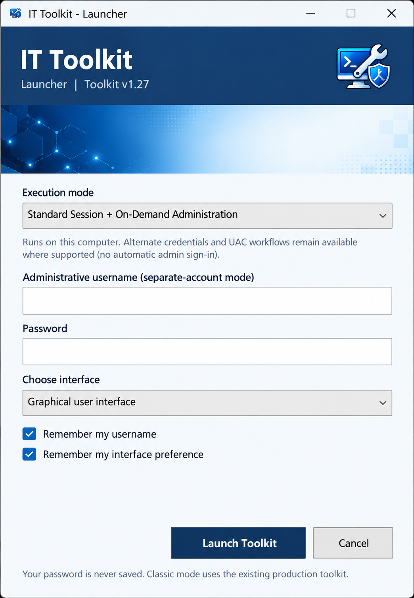
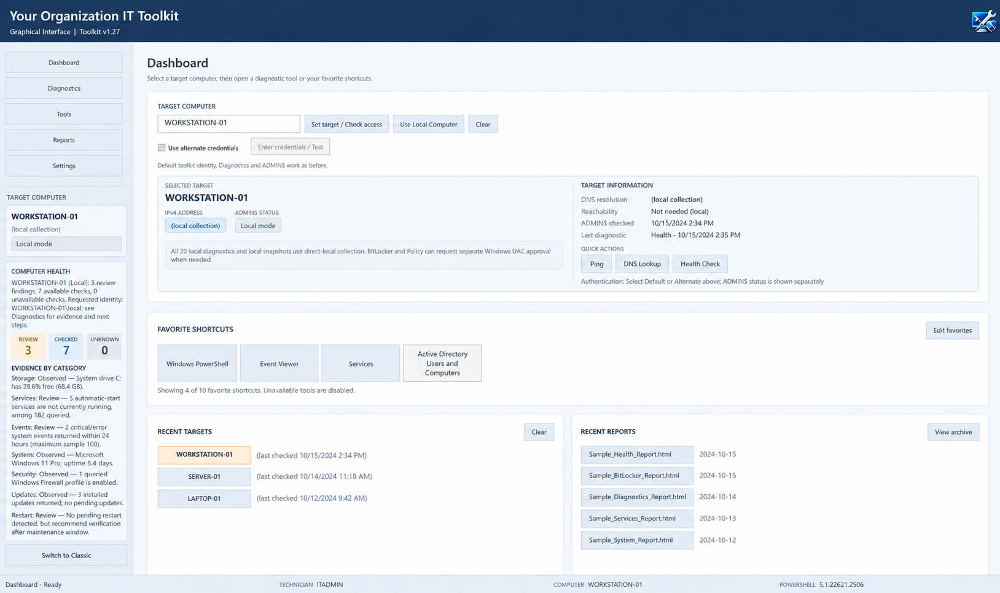

# IT Toolkit

**v1.27 — Development release candidate** · Windows PowerShell 5.1 · Windows administration and diagnostics

> **Release status:** v1.27 is under final validation on [`develop/v1.27`](https://github.com/wisper1977/ITToolkit/tree/develop/v1.27). **v1.26** on `main` remains the stable release until v1.27 passes testing and is approved. See [CHANGELOG.md](CHANGELOG.md) for development history and [ROADMAP.md](ROADMAP.md) for outstanding validation.

IT Toolkit is a portable, PowerShell-based Windows administration utility for technicians. It combines system diagnostics, access checks, reporting, inventory comparisons, and frequently used tools in graphical and Classic console interfaces.

## What's new in v1.27

- **Updated Launcher:** Choose Current Windows User, Separate Administrative Account, or Standard Session + On-Demand Administration.
- **Scoped elevation:** Run supported local BitLocker and Group Policy diagnostics through an explicit Windows UAC request without automatically elevating the entire Toolkit.
- **Shared execution and authorization:** GUI and Classic use consistent execution context, privilege requirements, and diagnostic preflight checks; mismatched or invalid authentication requests are blocked before collection.
- **Remote credential handling:** Explicit, target-bound Alternate credentials are supported for applicable diagnostics without silently falling back to another identity.
- **GUI and Classic alignment:** Shared diagnostic capabilities, simpler interface switching, and a reorganized Classic menu.
- **Local diagnostics:** Direct local collection is available for the supported diagnostic sections, without unnecessarily routing local checks through remote-management protocols.
- **Computer Health:** Evidence-based local and remote health checks with review, checked, and unavailable states, including storage, services, events, uptime, firewall, updates inventory, and pending-restart indicators.
- **Improved dashboard:** Compact, independently scrollable health details, better navigation and sizing, clearer target status, and remembered window preferences.
- **Reports and comparisons:** Improved saved-report handling, HTML/CSV/TXT export, structured inventory snapshots, and side-by-side changes between captures.
- **Version traceability:** Development versions include an abbreviated source commit identifier; diagnostic exports and structured snapshots include version information.
- **Tools and Favorites:** More flexible tool access, favorites, and an explicitly authorized Windows PowerShell (Administrator) launch option.
- **Refined branding and usability:** Updated Launcher presentation, improved long-label display, and revised README screenshots.

The list describes implemented development work, **not a claim that every feature has passed county-network validation**. Check the [roadmap](ROADMAP.md) before treating v1.27 as production-ready.

## Features

- Graphical (WPF) and Classic PowerShell interfaces for Windows technicians.
- Windows workstation and server diagnostics, including a complete 20-section diagnostic workflow.
- Remote DNS, ping, WMI, WinRM, and ADMIN$ accessibility checks.
- Default and explicitly provided Alternate remote authentication where supported.
- Read-only health analysis and exportable HTML, CSV, and TXT reports.
- JSON inventory snapshots and comparisons covering supported system categories.
- Integrated utility catalog, custom tools, and favorites; optional Sysinternals and PortQry support.

## Screenshots





## Requirements

- Windows 10/11 or compatible Windows Server, Windows PowerShell 5.1, and .NET/WPF for the graphical interface.
- Network connectivity and appropriate authorization for remote targets.
- Relevant Windows remote-management services, firewall permissions, and administrative rights where required.
- Optional: [Microsoft Sysinternals](https://learn.microsoft.com/en-us/sysinternals/) and [PortQry](https://www.microsoft.com/en-us/download/details.aspx?id=17148).

macOS and Linux are not supported. The launcher does not install an agent on remote systems.

## Installation

1. For the **stable v1.26 release**, download the package from [GitHub Releases](https://github.com/wisper1977/ITToolkit/releases/tag/v1.26). For the **v1.27 development build**, use the [development branch](https://github.com/wisper1977/ITToolkit/tree/develop/v1.27).
2. Extract the Toolkit to a local directory such as `C:\ITToolkit`, preserving the `Modules`, `Branding`, scripts, and configuration file layout.
3. Review `Toolkit-config.json` and adapt the organization branding, default authentication domain, report directory, and optional tool paths.
4. Run `Launch.cmd`, choose an execution mode, then open the graphical or Classic interface.

**Launcher execution modes**

- **Current Windows User:** Start the Toolkit under the launcher's current Windows identity.
- **Separate Administrative Account:** Supply an explicitly authorized administrative identity for the Toolkit process.
- **Standard Session + On-Demand Administration:** Keep the regular session identity; use existing explicit Alternate authentication and scoped UAC operations when supported.

The Launcher does not automatically sign in as an administrator or store passwords. Direct script launches and interface switching do not silently substitute credentials.

To start either interface directly from Windows PowerShell:

```powershell
# Classic interface
powershell.exe -NoProfile -File "C:\ITToolkit\ITToolkit.ps1"

# Graphical interface
powershell.exe -NoProfile -STA -File "C:\ITToolkit\ITToolkit-GUI.ps1"
```

Follow your organization's script-execution policy and code-signing requirements.

## Basic workflow

1. Select the local computer or an authorized remote target.
2. Choose Default authentication or explicit Alternate credentials, where supported.
3. Run the desired diagnostics or Computer Health checks.
4. Save an HTML, CSV, or TXT report, or capture an inventory snapshot.
5. Capture a later snapshot and compare changes when investigating a system.

A successful query does not guarantee that the machine is healthy. Unavailable checks should not be interpreted as passing results.

## Development and release versions

- **Development:** `Major.Minor.Commit` (example: `1.27.aa028e`), where the suffix identifies the verified Git source revision used for the build.
- **Stable:** `Major.Minor` (example: `1.27`), after required Windows validation and formal release approval.
- GUI, Classic, Launcher, and generated report metadata should consistently identify their source build. A configured suffix must not be assumed to identify a newer commit until the build version is regenerated and verified.

## Project layout

```text
ITToolkit/
├── Launch.cmd
├── ITToolkit-Launcher.ps1
├── ITToolkit-GUI.ps1
├── ITToolkit.ps1
├── Toolkit-config.json
├── Branding/
├── Modules/
└── Reports/
```

## Security and limitations

- Use IT Toolkit only for systems you are authorized to administer and follow least-privilege practices.
- Reports and snapshots may contain sensitive infrastructure details; do not commit them, credentials, or private keys to GitHub.
- Remote capabilities depend on the target OS, permissions, firewall, and management protocols.
- Inventory comparisons show collected differences, not comprehensive forensic changes or security compliance.
- Some separately authorized operations may require additional Windows permissions or UAC confirmation.
- The Report Archive **Open Folder** action has a known desktop-session limitation under some separate-administrator configurations; **Copy Folder Path** remains an alternative. See [ROADMAP.md](ROADMAP.md) for current status.

## Project history and plans

- [CHANGELOG.md](CHANGELOG.md) — development changes, fixes, and validation history.
- [ROADMAP.md](ROADMAP.md) — remaining v1.27 release checks and planned future work.
- [GitHub Releases](https://github.com/wisper1977/ITToolkit/releases) — published stable releases.
